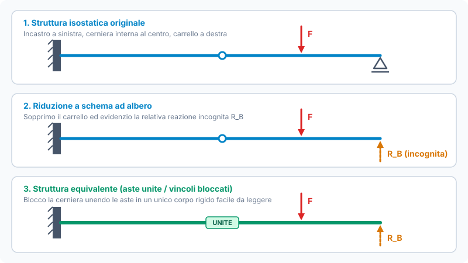

### Reazioni vincolari e metodo dello schema ad albero

Le reazioni vincolari sono le forze (o coppie) che si generano in risposta all'azione dei vincoli, in accordo con il terzo principio della dinamica (azione e reazione): ogni volta che un vincolo impedisce un grado di libertà, nasce una reazione corrispondente al movimento bloccato.
Per il calcolo delle reazioni su strutture isostatiche complesse, il **metodo dello schema ad albero** permette di velocizzare notevolmente la risoluzione, evitando di dover "esplodere" l'intera struttura e impostare tre equazioni di equilibrio per ogni singola asta. La procedura si articola in quattro passaggi:
 1. **Creazione dello schema ad albero:** si sopprimono tutti i vincoli esterni (assoluti) tranne uno (sufficiente a garantire l'isostaticità, come un incastro) e si "aprono" eventuali anelli chiusi (maglie) sopprimendo i relativi vincoli interni.
 2. **Analisi cinematica tramite schema equivalente:** si prende in esame uno alla volta i vincoli precedentemente rimossi, osservando i movimenti assoluti o relativi che esso permette una volta liberato, e si scrive la corrispondente equazione di equilibrio. Per evitare errori visivi e semplificare lo studio, è molto utile **ridisegnare una struttura equivalente in cui tutti gli altri vincoli vengono fisicamente bloccati**: i vincoli interni diventano incastri interni — unendo di fatto le aste in un unico corpo rigido — mentre quelli esterni diventano incastri assoluti. In questo modo si isola un singolo grado di libertà e i movimenti risultano immediatamente leggibili.
3. **Iterazione:** si ripete questo procedimento per ciascun vincolo soppresso, fino a determinare tutte le incognite.
4. **Calcolo finale e verifica:** una volta ricavate le reazioni, si rimuove anche l'ultimo vincolo esterno rimasto (o si applicano le equazioni cardinali della statica all'intera struttura) per determinarne il valore e verificare che l'equilibrio globale sia soddisfatto.

In conclusione, lo schema ad albero  supportato dal disegno dei corpi rigidi equivalenti  si rivela un metodo estremamente efficace per disaccoppiare le equazioni, semplificare l'analisi visiva e ridurre al minimo il rischio di errori di calcolo.

